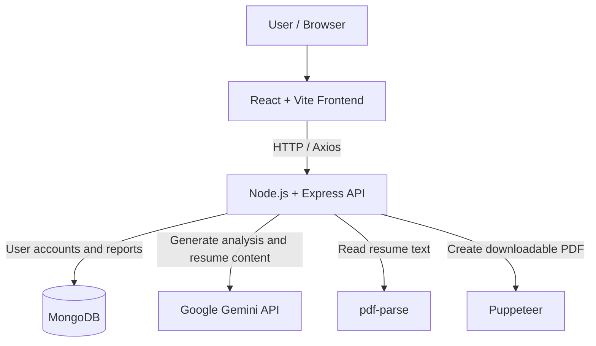

# Interview Prep AI

**AI-powered interview preparation, tailored to a job description and your resume.**

Interview Prep AI is a full-stack web application that helps candidates prepare for job interviews by analyzing a resume and a target job description. It generates role-specific technical and behavioral questions, highlights skill gaps, builds a preparation roadmap, and can generate a tailored resume PDF.

> **Project status:** Runs locally. A public hosted demo is not yet available.

## Features

- **Account registration and sign-in** with JWT-based authentication and cookies.
- **Resume analysis:** upload a PDF resume and extract its text.
- **Job-description matching:** enter the requirements of a target role and receive an AI-generated match score.
- **Technical and behavioral interview questions:** practice questions with the interviewer's intent and suggested answer guidance.
- **Skill-gap identification:** see areas to improve, with low/medium/high severity.
- **Personalized preparation roadmap:** a day-by-day plan of focus areas and tasks.
- **Interview report history:** revisit previously generated reports saved in MongoDB.
- **Tailored resume export:** generate and download a resume PDF using AI and Puppeteer.

## Tech Stack

| Layer | Technologies |
| --- | --- |
| Frontend | React 19, Vite 7, React Router, Axios, SCSS |
| Backend | Node.js, Express 5 |
| Database | MongoDB, Mongoose |
| Authentication | JSON Web Tokens (JWT), bcryptjs, cookies |
| AI | Google Gemini API (`@google/genai`) |
| File processing | Multer, pdf-parse, Puppeteer |

## Architecture



**Typical flow:** Sign in → upload a resume PDF → paste a job description → generate an AI interview report → review questions, skill gaps and roadmap → optionally download a tailored resume PDF.

## Project Structure

```text
Interview-Prep-AI/
├── Backend/
│   ├── server.js
│   ├── package.json
│   └── src/
│       ├── config/
│       ├── controllers/
│       ├── middlewares/
│       ├── models/
│       ├── routes/
│       └── services/
├── Frontend/
│   ├── package.json
│   ├── vite.config.js
│   └── src/
│       └── features/
│           ├── auth/
│           └── interview/
└── README.md
```

## Run Locally

### Prerequisites

- **Node.js** 20.19+ (or a compatible newer LTS release) and npm
- **MongoDB**, either installed locally or hosted on MongoDB Atlas
- **Google Gemini API key** from [Google AI Studio](https://aistudio.google.com/apikey)
- **Git** (for cloning the repository)

### 1. Clone the repository

```bash
git clone https://github.com/Rohiitian-0111/Interview-Prep-AI.git
cd Interview-Prep-AI
```

### 2. Configure the backend

Open a terminal in the project directory:

```bash
cd Backend
npm install
```

Create a **`Backend/.env`** file and set:

```dotenv
MONGO_URI=mongodb://127.0.0.1:27017/interview_ai
JWT_SECRET=replace_with_a_long_random_secret
GOOGLE_GENAI_API_KEY=your_gemini_api_key
```

- If using **MongoDB Atlas**, replace `MONGO_URI` with the Atlas connection string.
- Replace `JWT_SECRET` with a strong random value.
- Replace `GOOGLE_GENAI_API_KEY` with your own API key.
- **Never commit `.env` files or API keys.**

Start the backend:

```bash
npm run dev
```

The API listens on **http://localhost:3000**. Ensure MongoDB is running and the server prints `Connected to Database`.

### 3. Start the frontend

In a **second terminal** at the project root:

```bash
cd Frontend
npm install
npm run dev
```

Open **http://localhost:5173** in your browser.

> The frontend currently uses `http://localhost:3000` as its API base URL, and the backend permits the frontend origin `http://localhost:5173` in its CORS configuration. Update those values if you use different ports or deploy the app.

### 4. Use the application

1. Register an account or sign in.
2. Upload a **PDF** resume.
3. Paste the job description of the role you are targeting.
4. Generate your interview strategy.
5. Review technical/behavioral questions, skill gaps, and the preparation roadmap.
6. Open saved reports or download the AI-generated resume PDF.

## Screenshots

Add screenshots to `docs/screenshots/` and reference them here after uploading the image files to GitHub. For example:

```markdown


```

## Notes and Current Limitations

- **Resume format:** the backend currently extracts text from **PDFs**. The existing frontend wording also mentions DOCX, but DOCX parsing is not implemented in the checked-in backend.
- **Upload size:** the backend currently limits an uploaded file to **3 MB**.
- **Job description:** the checked-in version accepts **pasted text**; uploading a job-description PDF is a possible future enhancement.
- **AI usage:** Gemini availability and quotas depend on the API key and selected model. The model ID is configured in `Backend/src/services/ai.service.js`.
- **Privacy:** resumes and job descriptions are sent to the configured AI service for processing. Avoid submitting sensitive data without understanding that service's policies.

## Roadmap

- [ ] Job-description PDF upload and text extraction
- [ ] Stronger file validation and API error handling
- [ ] Improved mobile responsiveness and accessibility
- [ ] Deployment configuration and live demo
- [ ] Automated tests


## Repository

Maintained at **[Rohiitian-0111/Interview-Prep-AI](https://github.com/Rohiitian-0111/Interview-Prep-AI)**.
